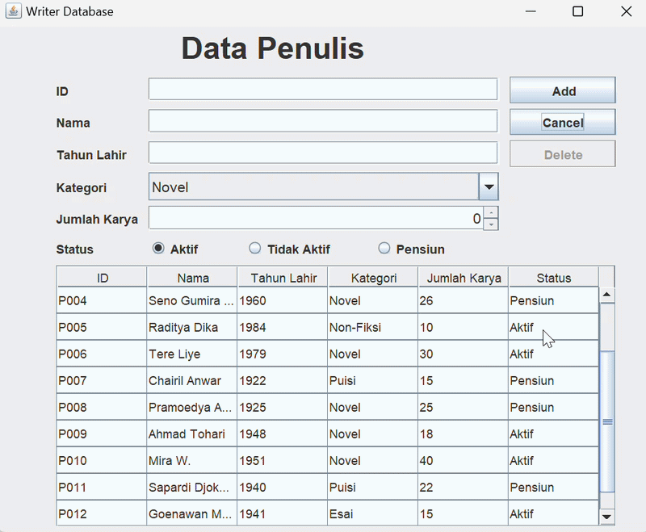
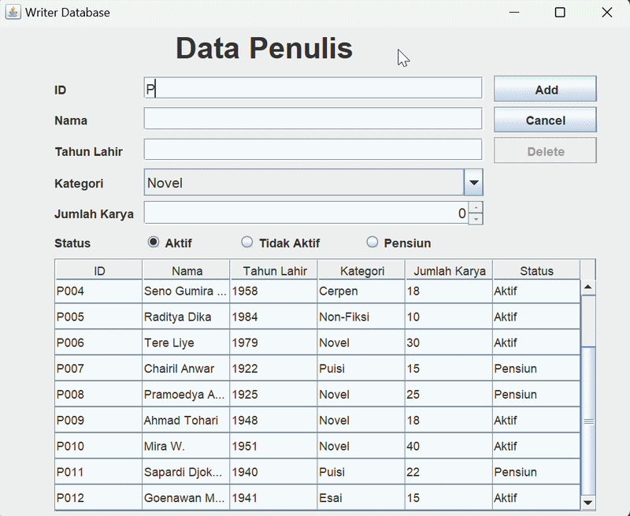
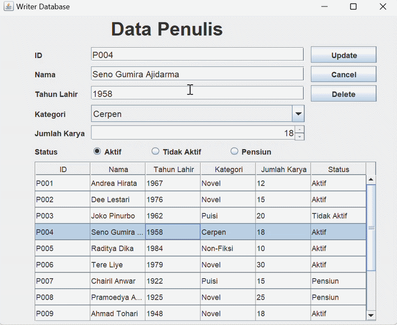
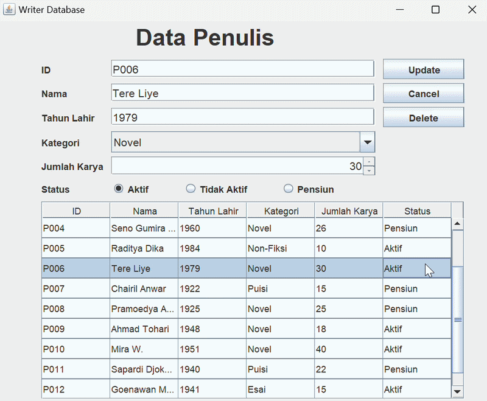
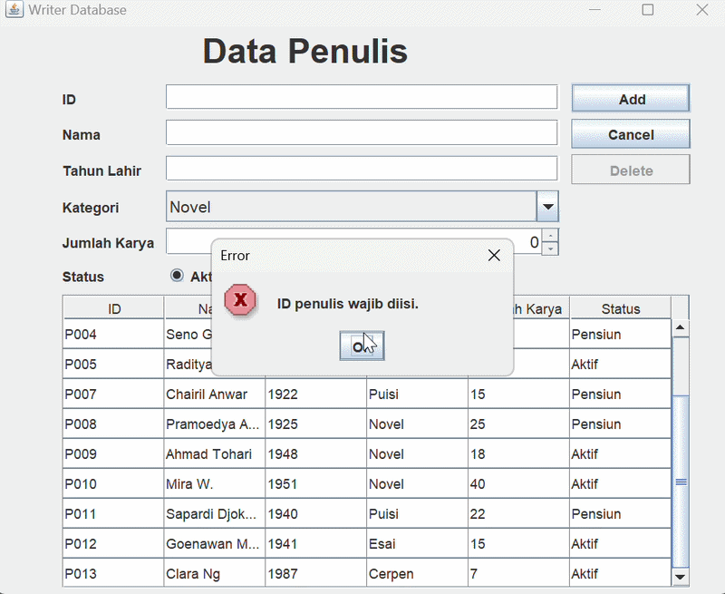
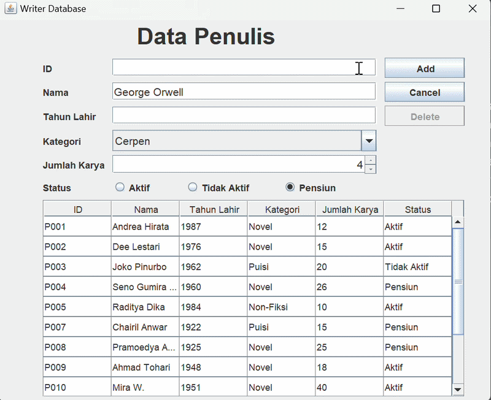
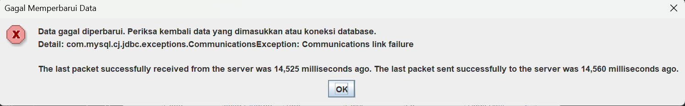

# Tugas Praktikum 5 DPBO

## Janji

Saya Ingrid Gabryella Nainggolan dengan NIM 2506442 mengerjakan TP 5 dalam mata kuliah Desain dan Pemrograman Berorientasi Objek untuk keberkahan-Nya maka saya tidak melakukan kecurangan seperti yang telah dispesifikasikan. Aamiin.

---

## Tujuan Program

Tujuan pembuatan aplikasi Writer Database adalah:

1. Mengimplementasikan operasi CRUD (*Create, Read, Update, Delete*) yang terhubung dengan database MySQL.
2. Mempermudah pengelolaan data penulis melalui antarmuka grafis.
3. Menerapkan penggunaan kelas dan objek dalam Java.
4. Mengimplementasikan pengambilan dan penyimpanan data menggunakan database.
5. Menerapkan validasi input dan penanganan kesalahan (*error handling*) sesuai implementasi program.

## Teknologi yang Digunakan

- **Bahasa Pemrograman:** Java
- **GUI:** Java Swing
- **Database:** MySQL
- **Database Connectivity:** JDBC
- **Komponen GUI:** `JPanel`, `JTextField`, `JSpinner`, `JComboBox`, `JRadioButton`, `JTable`, `JButton`, dan `JLabel`
- **IDE:** IntelliJ IDEA

## Desain Program

### 1. Desain Antarmuka

Antarmuka aplikasi terdiri atas formulir input data penulis, tombol operasi, dan tabel yang menampilkan data penulis.

Formulir digunakan untuk memasukkan atau mengubah informasi penulis, sedangkan tabel digunakan untuk menampilkan data yang tersimpan di database.

### 2. Struktur Database

Aplikasi menggunakan database MySQL dengan nama `db_person` dan tabel `penulis`.

Tabel `penulis` memiliki atribut sebagai berikut:

| Atribut | Tipe Data | Deskripsi |
|---|---|---|
| `id` | `VARCHAR(255)` | Identitas unik penulis dan primary key. |
| `nama` | `VARCHAR(255)` | Nama penulis. |
| `tahunlahir` | `INT` | Tahun lahir penulis. |
| `kategori` | `VARCHAR(255)` | Kategori karya penulis. |
| `jumlahkarya` | `INT` | Jumlah karya penulis. |
| `status` | `VARCHAR(30)` | Status penulis, yaitu Aktif, Tidak Aktif, atau Pensiun. |

Atribut `id` digunakan sebagai primary key sehingga setiap penulis memiliki identitas yang unik.

### 3. Struktur Kelas

Program terdiri dari dua kelas utama, yaitu `PeopleMenu` dan `Database`.

| Kelas | Tanggung Jawab |
|---|---|
| `PeopleMenu` | Mengatur antarmuka grafis, menerima input pengguna, menjalankan operasi CRUD, melakukan validasi, dan menampilkan dialog informasi maupun error. |
| `Database` | Menangani koneksi ke database MySQL serta menjalankan query untuk mengambil, menambahkan, memperbarui, dan menghapus data. |

### 4. Komponen Antarmuka

| Komponen | Fungsi |
|---|---|
| ID Field | Memasukkan identitas penulis. |
| Nama Field | Memasukkan nama penulis. |
| Tahun Field | Memasukkan tahun lahir penulis. |
| Kategori ComboBox | Memilih kategori karya penulis. |
| Jumlah Karya Spinner | Menentukan jumlah karya penulis. |
| Status RadioButton | Memilih status penulis. |
| Tabel Data Penulis | Menampilkan data penulis dari database. |
| Tombol Add | Menambahkan data penulis baru. |
| Tombol Update | Memperbarui data penulis yang dipilih. |
| Tombol Delete | Menghapus data penulis yang dipilih. |
| Tombol Cancel | Mengosongkan form dan membatalkan pemilihan data. |

## Fitur Program

### 1. Create — Menambahkan Data

Fitur Create digunakan untuk menambahkan data penulis baru ke dalam database.

Alur proses:

1. Pengguna mengisi formulir data penulis.
2. Pengguna menekan tombol **Add**.
3. Program memeriksa kelengkapan dan validitas input.
4. Program memeriksa apakah ID penulis sudah digunakan.
5. Jika data valid dan ID belum digunakan, program menjalankan perintah SQL `INSERT`.
6. Tabel diperbarui untuk menampilkan data terbaru.
7. Formulir dikosongkan setelah data berhasil ditambahkan.

Jika input tidak valid atau ID sudah digunakan, program menampilkan dialog error.

### 2. Read — Menampilkan Data

Fitur Read digunakan untuk menampilkan data penulis yang tersimpan di database.

Alur proses:

1. Program menjalankan perintah SQL `SELECT` untuk mengambil data dari tabel `penulis`.
2. Program membaca hasil query.
3. Data dimasukkan ke dalam model tabel.
4. Tabel menampilkan informasi penulis sesuai kolom yang tersedia.

### 3. Update — Memperbarui Data

Fitur Update digunakan untuk mengubah informasi penulis yang sudah tersimpan di database.

Alur proses:

1. Pengguna memilih salah satu baris pada tabel.
2. Program menampilkan data penulis yang dipilih ke dalam formulir.
3. Tombol **Add** berubah menjadi **Update**.
4. Pengguna mengubah informasi yang diperlukan.
5. Pengguna menekan tombol **Update**.
6. Program memvalidasi input.
7. Program memperbarui data menggunakan perintah SQL `UPDATE`.
8. Tabel diperbarui dan formulir dikosongkan setelah proses berhasil.

Jika input tidak valid atau ID yang digunakan sudah dimiliki penulis lain, program menampilkan dialog error.

### 4. Delete — Menghapus Data

Fitur Delete digunakan untuk menghapus data penulis yang dipilih dari database.

Alur proses:

1. Pengguna memilih data penulis pada tabel.
2. Pengguna menekan tombol **Delete**.
3. Program menampilkan dialog konfirmasi penghapusan.
4. Jika pengguna memilih **Yes**, program menjalankan perintah SQL `DELETE`.
5. Jika pengguna memilih **No**, penghapusan dibatalkan.
6. Setelah penghapusan berhasil, tabel diperbarui dan formulir dikosongkan.

### 5. Cancel — Membatalkan Pengisian

Tombol Cancel digunakan untuk mengosongkan formulir dan membatalkan pemilihan data.

Ketika tombol ditekan, program mengosongkan field input, mengembalikan kategori dan status ke pilihan awal, menghapus seleksi pada tabel, mengubah tombol Update kembali menjadi Add, serta menonaktifkan tombol Delete.

## Penyimpanan Data

Aplikasi Writer Database menggunakan database MySQL sebagai media penyimpanan data penulis.

Koneksi antara aplikasi Java dan database dilakukan melalui JDBC. Data yang ditambahkan, diperbarui, atau dihapus akan diproses melalui query SQL.

Berbeda dengan penyimpanan menggunakan `ArrayList`, data pada aplikasi ini disimpan dalam database sehingga dapat tersedia kembali ketika aplikasi dijalankan selama data masih tersimpan dan koneksi database dapat digunakan.

## Alur Kerja Program

Secara umum, alur kerja aplikasi Writer Database adalah sebagai berikut:

1. Program dijalankan.
2. Objek `Database` dibuat untuk menangani koneksi dan operasi database.
3. Antarmuka aplikasi ditampilkan.
4. Program mengambil data penulis dari database.
5. Data ditampilkan pada tabel.
6. Pengguna memilih operasi yang ingin dilakukan.
7. Program menjalankan operasi Create, Read, Update, atau Delete.
8. Program melakukan validasi input apabila diperlukan.
9. Program menjalankan query SQL sesuai operasi yang dipilih.
10. Tabel diperbarui setelah operasi berhasil.
11. Program menampilkan dialog informasi atau error sesuai hasil operasi.

## Error Handling

Error handling digunakan untuk menangani kondisi ketika pengguna memberikan input yang tidak sesuai atau operasi database mengalami kegagalan.

### 1. Field Wajib Kosong

ID, nama, dan tahun lahir wajib diisi. Jika salah satu field tersebut kosong, program menampilkan dialog error dan membatalkan proses penambahan atau pembaruan data.

### 2. Tahun Lahir Tidak Valid

Tahun lahir harus berupa angka dan berada pada rentang 1 sampai 2026. Program menampilkan dialog error apabila tahun lahir tidak diisi, bukan angka, atau berada di luar rentang tersebut.

### 3. Jumlah Karya Tidak Valid

Jumlah karya harus lebih dari 0. Jika jumlah karya tidak memenuhi ketentuan, program menampilkan dialog error.

### 4. ID Duplikat

ID penulis harus unik. Jika pengguna memasukkan ID yang sudah digunakan ketika menambahkan data, program menolak proses penambahan dan menampilkan dialog error.

Ketika memperbarui data, program juga menangani kondisi ketika ID yang dimasukkan sudah digunakan oleh penulis lain.

### 5. Kesalahan Database

Jika operasi database gagal, program menampilkan dialog error yang berisi informasi kegagalan. Penanganan ini diterapkan pada operasi penambahan, pembaruan, dan penghapusan data.

### 6. Konfirmasi Penghapusan

Sebelum menghapus data, program menampilkan dialog konfirmasi. Data hanya dihapus jika pengguna memilih **Yes**. Jika pengguna memilih **No**, proses penghapusan tidak dijalankan.

## Hasil Pengujian

Pengujian dilakukan untuk memastikan fitur pengelolaan data penulis berjalan sesuai fungsinya.

| No. | Fitur yang Diuji | Skenario Pengujian | Hasil yang Diharapkan |
|---|---|---|---|
| 1 | Read | Membuka aplikasi | Data penulis ditampilkan pada tabel. |
| 2 | Create | Menambahkan data baru dengan input valid | Data baru tersimpan dan muncul pada tabel. |
| 3 | Update | Mengubah data penulis yang dipilih | Data diperbarui dan tabel menampilkan perubahan. |
| 4 | Delete | Menghapus data penulis yang dipilih | Data dihapus setelah konfirmasi dan tidak lagi muncul pada tabel. |
| 5 | Cancel | Menekan tombol Cancel | Formulir dikosongkan dan pemilihan data dibatalkan. |
| 6 | Validasi input | Membiarkan field wajib kosong | Program menampilkan dialog error. |
| 7 | Validasi tahun lahir | Memasukkan tahun lahir yang tidak valid | Program menampilkan dialog error. |
| 8 | Validasi jumlah karya | Memasukkan jumlah karya 0 | Program menampilkan dialog error. |
| 9 | Validasi ID | Memasukkan ID yang sudah digunakan | Program menolak ID duplikat dan menampilkan dialog error. |
| 10 | Validasi saat Update | Memasukkan ID milik penulis lain | Program menolak perubahan dan menampilkan dialog error. |


## Struktur Dokumentasi Repository

```text
TP5DPBO2526C2/
├── Dokumentasi/
│   ├── add_data.gif
│   ├── data_wajib_isi.gif
│   ├── delete_data.gif
│   ├── id_duplikat_tahun_valid.gif
│   ├── read_data.gif
│   ├── update_data.gif
│   └── add_data.mp4
├── PersonData/
│   ├── .idea/
│   ├── lib/
│   │   └── mysql-connector-j.jar
│   ├── out/
│   ├── src/
│   │   ├── Database.java
│   │   ├── PeopleMenu.form
│   │   ├── PeopleMenu.java
│   │   └── Person.java
│   ├── .gitignore
│   └── PersonData.iml
├── db_person.sql
└── README.md
```


## Kesimpulan

Aplikasi Writer Database merupakan aplikasi pengelolaan data penulis berbasis Java Swing yang terhubung dengan database MySQL.

Program menerapkan operasi CRUD untuk menampilkan, menambahkan, memperbarui, dan menghapus data penulis. Selain itu, program memiliki validasi input, pemeriksaan ID duplikat, dialog konfirmasi penghapusan, serta penanganan kesalahan untuk membantu menjaga konsistensi data dan memberikan informasi kepada pengguna ketika terjadi kesalahan.

## Dokumentasi Program

Dokumentasi berikut memperlihatkan pelaksanaan operasi CRUD dan validasi pada aplikasi. Setiap GIF ditampilkan dengan lebar 500 piksel.

### 1. Read — Menampilkan Data

Menampilkan data penulis yang tersimpan di database MySQL.

<p align="left">
  
</p>

### 2. Create — Menambahkan Data

Memperlihatkan proses pengisian formulir dan penambahan data penulis baru ke database.

<p align="left">
  
</p>

### 3. Update — Memperbarui Data

Memperlihatkan proses memilih data penulis, mengubah informasi, dan menyimpan perubahan.

<p align="left">
  
</p>

### 4. Delete — Menghapus Data

Memperlihatkan proses penghapusan data penulis melalui tombol Delete dan dialog konfirmasi.

<p align="left">
  
</p>

### 5. Error Handling — Field Wajib Diisi

Memperlihatkan dialog error ketika pengguna mencoba menambahkan atau memperbarui data dengan field wajib yang belum diisi.

<p align="left">
  
</p>

### 6. Error Handling — ID Duplikat dan Tahun Lahir Tidak Valid

Memperlihatkan penanganan kesalahan ketika ID penulis sudah digunakan atau tahun lahir tidak memenuhi ketentuan.

<p align="left">
  
</p>

### 7. Error Handling — Koneksi Database Gagal

Menampilkan dialog error ketika aplikasi gagal terhubung ke database MySQL. Pesan ini membantu pengguna mengetahui bahwa koneksi database mengalami kendala sehingga operasi pengelolaan data tidak dapat dilakukan dengan semestinya.


<p align="left">
  
</p>